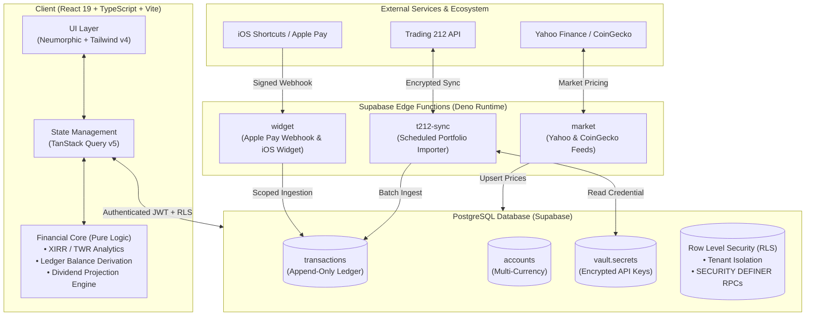

# Strata

<div align="center">

**Personal Wealth & Portfolio Intelligence Platform**

*A production-grade, ledger-backed financial operating system uniting equities, crypto, cashflow, and Apple Pay automation into a unified net-worth view.*

[](https://www.typescriptlang.org/)
[](https://react.dev/)
[](https://supabase.com/)
[](https://tailwindcss.com/)
[](https://vitest.dev/)
[](./LICENSE)

</div>

---

## 📌 Executive Summary

Strata is a private, full-stack fintech platform designed to solve the fragmentation of modern personal wealth tracking. Instead of relying on multiple disconnected apps (spreadsheets for net worth, broker apps for stocks, budgeting tools for expenses), Strata consolidates everything into a single ledger-derived system of record with real-time analytics, automated broker imports, and contactless payment ingestion.

Published as an engineering portfolio piece and personal daily driver, it demonstrates high-integrity software design: **pure mathematical domain modelling**, **immutable ledger accounting**, **hardened PostgreSQL Row Level Security (RLS)**, and **real-world iOS ecosystem integrations**.

---

## 🚀 Key Capabilities

### 1. Ledger-Derived Accounting & Net Worth
- **Single Source of Truth**: Balances, historical positions, and net worth are never statically stored; they are functionally derived from the transaction ledger via pure, tested functions (`deriveBalances`, `computeNetWorth`).
- **Debt by Sign, Not Separate Tables**: Assets and liabilities are dynamically classified by account type or balance sign (e.g., an overdrawn account or credit line automatically transitions into a liability without manual restructuring).
- **Exact Monetary Precision**: Financial math is executed with zero floating-point drift using `decimal.js` on the client and high-precision `numeric(19,4)` in PostgreSQL.

### 2. Investment Portfolio & Advanced Analytics
- **Performance Metrics**: Automated calculation of **XIRR** (Internal Rate of Return / Money-Weighted Return) and **TWR** (Time-Weighted Return) using historical cashflow sequences.
- **Position Tracking**: Weighted-average cost basis, unrealized P&L, daily gains, and portfolio asset allocation breakdowns.
- **Dividend Forecasting**: Forward dividend projections, ex-dividend calendar scheduling, and historical yield-on-cost metrics.
- **Crypto & Multi-Asset Support**: Real-time crypto tracking via CoinGecko and global equities pricing with foreign exchange (FX) conversion.

### 3. Apple Pay & Contactless Workflow (iOS Shortcuts)
- **Zero-Friction Logging**: Serverless webhook ingestion via Supabase Edge Functions allows instant transaction logging directly from iPhone/Apple Watch contactless taps.
- **Smart Merchant Intelligence**: Automatically matches recurring merchants (e.g., grocery stores, gas stations) to the user's preferred funding account (e.g., Edenred meal cards vs. personal checking) based on transaction history.
- **Pending Review Inbox**: Contactless payments land in an interactive review queue with 1-tap confirmation, account reassignment, and automatic category suggestions.

### 4. Automated Broker Synchronization (Trading 212)
- **Serverless Importer**: Deno Edge Functions incrementally sync equity orders, dividends, and cash movements using the official Trading 212 API.
- **Vault Security**: API keys and secrets are encrypted at rest using **Supabase Vault** (libsodium) and are never exposed to client bundles or browser storage.

### 5. Mobile Experience & Desktop UX
- **Design System**: Responsive interface with smooth bottom sheets, glassmorphic HUD headers, light/dark modes, and a privacy mode that blurs financial values.
- **Command Palette (`⌘K` / `Ctrl+K`)**: Rapid navigation, instant transaction creation, and keyboard-first actions.
- **iOS Home Screen Widget**: Token-authenticated Scriptable widget providing at-a-glance net worth and daily asset changes.

---

## 🏗️ System Architecture



---

## 🛡️ Security Architecture & Audit Report

Strata follows defense-in-depth principles designed for sensitive personal financial data:

| Security Vector | Implementation & Defensive Mechanism |
| :--- | :--- |
| **Row Level Security (RLS)** | Enabled across 100% of tables. Every query is filtered by `auth.uid() = user_id`. Composite foreign keys `(account_id, user_id)` guarantee transactional ownership integrity. |
| **Credential Encryption** | Broker keys and sensitive tokens are sealed inside PostgreSQL via `supabase_vault` using libsodium symmetric encryption. |
| **Search-Path Injection Defense** | All `SECURITY DEFINER` functions enforce `SET search_path = ''` and revoke execution rights from `public` to prevent path-hijacking vulnerabilities. |
| **Scoped Service Roles** | Unauthenticated callers cannot trigger Edge Function batch jobs. Ingestion endpoints strictly validate service-role keys for crons or verified JWTs for users. |
| **Webhook Protection** | Apple Pay and widget endpoints use high-entropy (48-character hex) random tokens with strict bounds checking (e.g., maximum amount caps, sanitized string lengths). |
| **Zero XSS Vectors** | No `dangerouslySetInnerHTML`, `eval()`, or unescaped HTML interpolation. All user inputs are strictly typed and sanitized before state commits. |

---

## 📁 Repository Structure

```
strata/
├── src/
│   ├── core/                  # Pure financial domain logic (Zero UI/DB dependencies)
│   │   ├── analytics/         # XIRR, TWR, cashflow series, monthly delta calculations
│   │   ├── balances/          # Pure balance derivation from transaction sequences
│   │   ├── dividends/         # Dividend yield and cash forecasting engine
│   │   ├── money/             # Arbitrary-precision decimal arithmetic (decimal.js)
│   │   ├── networth/          # Asset/liability classification and net worth math
│   │   └── positions/         # Portfolio position reconstruction & rebalancing logic
│   ├── features/              # Feature modules (Domain components, hooks, modals)
│   │   ├── accounts/          # Account management, targets, and payday allocations
│   │   ├── analytics/         # Wealth trajectory and performance charts
│   │   ├── crypto/            # CoinGecko integration and crypto holdings
│   │   ├── dashboard/         # Financial timeline, pulse cards, and net worth donut
│   │   ├── dividends/         # Forward dividend schedule view
│   │   ├── expenses/          # Budget pacing, categories, and split expenses
│   │   ├── integrations/      # Trading 212 setup and Apple Shortcuts webhook guide
│   │   ├── positions/         # Stock/ETF holdings, prices, and Yahoo symbol mapping
│   │   └── transactions/      # Transaction list, edit sheet, and pending review inbox
│   ├── db/                    # Supabase client, typed schemas, and row mappers
│   └── ui/                    # Design primitives, toasts, fields, and command palette
├── supabase/
│   ├── functions/             # Deno Edge Functions (market, t212-sync, widget)
│   │   └── _shared/           # Shared modules (FX math, portfolio mapping, backoff)
│   └── migrations/            # Version-controlled SQL migrations & RLS policies
└── scripts/                   # Auxiliary CLI tools (VAPID generation, seeders)
```

---

## 🧪 Testing & Verification

The core calculation engines are backed by an extensive automated test suite run via [Vitest](https://vitest.dev/):

```bash
# Run unit and integration tests
npm test

# Run type-checking across TypeScript modules
npm run typecheck

# Build for production
npm run build
```

**Key test suites covered:**
- **Ledger Invariants**: Ensures transactions always correctly alter account balances and preserve debit/credit signs.
- **XIRR & TWR Math**: Verified against known Newton-Raphson convergence sets and standard financial benchmarks.
- **Payday Pacing & Budgets**: Edge-case testing for leap years, irregular month lengths, and multi-currency conversions.
- **Reconstruction Algorithms**: Validates that historical positions accurately reconstruct from sequence logs.

---

## 🛠️ Local Development Setup

### Prerequisites
- Node.js 20+
- [Supabase CLI](https://supabase.com/docs/guides/cli) (optional, for local Edge Functions)

### 1. Clone & Install
```bash
git clone https://github.com/bernam07/strata.git
cd strata
npm install
```

### 2. Environment Configuration
Copy `.env.example` to `.env`:
```bash
cp .env.example .env
```
Fill in your Supabase project credentials:
```env
VITE_SUPABASE_URL=https://your-project.supabase.co
VITE_SUPABASE_ANON_KEY=your-anon-key
```

### 3. Run Development Server
```bash
npm run dev
```

---

## 📄 License

This project is licensed under the [MIT License](./LICENSE).
