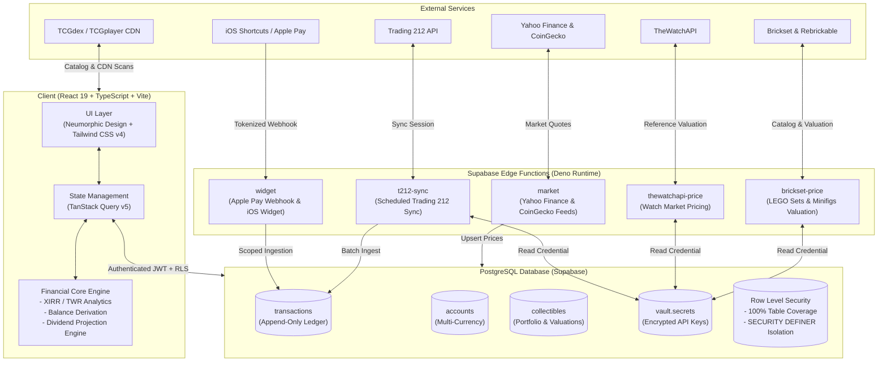

# Strata

<div align="center">

**Personal Wealth & Portfolio Intelligence Platform**

*A production-grade, ledger-backed financial operating system uniting equities, crypto, alternative assets, cashflow, and Apple Pay automation into a unified net-worth view.*

[](https://www.typescriptlang.org/)
[](https://react.dev/)
[](https://supabase.com/)
[](https://tailwindcss.com/)
[](https://vitest.dev/)
[](./LICENSE)

</div>

---

## Executive Summary

Strata is a private, full-stack personal finance and wealth intelligence platform designed to eliminate the fragmentation of personal balance sheets. Rather than dispersing asset tracking across separate broker apps, bank portals, crypto dashboards, and physical collection spreadsheets, Strata consolidates everything into a single ledger-derived system of record.

Engineered with high-integrity software principles, the platform features:
- **Pure Mathematical Domain Modeling**: Balances, historical positions, and net worth are functionally derived from transaction sequences with zero floating-point error.
- **Immutable Ledger Accounting**: Financial events are modeled as append-only transactions. Debt and assets are distinguished by sign rather than redundant tables.
- **Hardened PostgreSQL Row Level Security (RLS)**: Complete tenant isolation where every table enforces `auth.uid() = user_id` and all secrets reside inside PostgreSQL Vault.
- **Real-World Automation**: Serverless ingestion webhooks for Apple Pay / Wallet, scheduled broker sync with Trading 212, and valuation pipelines for alternative assets.

---

## Key Capabilities

### 1. Ledger-Derived Accounting & Net Worth
- **Single Source of Truth**: Balances and net-worth time series are never stored statically; they are functionally computed from immutable transaction records via pure, deterministic functions (`deriveBalances`, `computeNetWorth`).
- **Debt by Sign**: Financial classification adapts automatically to balance signs. Overdrafts and credit lines naturally transition between asset and liability without schema adjustments.
- **Exact Precision**: Financial math avoids binary floating-point drift using `decimal.js` on the client and high-precision `numeric(19,4)` in PostgreSQL.

### 2. Investment Portfolio & Advanced Analytics
- **Performance Engines**: Calculates Money-Weighted Return (**XIRR**) and Time-Weighted Return (**TWR**) across historical cashflows and asset valuations.
- **Holdings Management**: Tracks volume-weighted average price (VWAP), unrealized gain/loss, day deltas, and automated target rebalancing weights.
- **Forward Dividend Forecasts**: Projects upcoming dividend income, schedules ex-dividend dates, and computes yield-on-cost metrics.
- **Multi-Currency & Crypto**: Integrates Frankfurter ECB rates for currency conversion, Yahoo Finance for global equity pricing, and CoinGecko for cryptocurrency assets.

### 3. Alternative Assets & Collectibles Valuation
- **Pokemon TCG**: Live integration with TCGdex, pokemontcg.io, and TCGplayer CDN with multi-provider image fallback resolution. Pricing matches Collectr market values (TCGplayer Market Price converted to EUR via ECB exchange rates) with finish-level granularity (Normal, Holofoil, Reverse Holofoil, 1st Edition).
- **LEGO Sets & Minifigures**: Fast catalog lookup via Rebrickable paired with market valuation engines through Brickset (current new/used market values and original retail pricing).
- **Luxury Watches**: Real-time market valuation and reference search via TheWatchAPI, cataloging case diameter, movement caliber, bezel material, and reference specifications.
- **Net Worth Toggle**: Each collectible category includes granular inclusion controls, enabling users to isolate speculative assets from core liquid net worth.

### 4. Apple Pay & Contactless Workflow
- **Instant Webhook Ingestion**: Edge Function ingestion allows instant transaction logging directly from iOS Shortcuts when tapping an Apple Pay terminal.
- **Merchant Intelligence**: Matches merchants to historical funding sources (e.g., supermarket expenses to meal vouchers vs. checking accounts).
- **Review Queue**: Contactless transactions land in an inbox with one-tap confirmation, category assignment, and destination account adjustments.

### 5. Automated Integrations & Vault Security
- **Trading 212 Synchronization**: Scheduled Deno Edge Functions incrementally sync equity orders, dividends, and cash movements using the official Trading 212 API.
- **Encrypted Credential Storage**: All external API keys (Trading 212, Brickset, TheWatchAPI, Rebrickable) are sealed in `supabase_vault` (libsodium encryption) and never leaked to the client bundle.

### 6. Activity Ledger & User Experience
- **Fluid Pagination**: Incremental on-demand loading (25 items per batch) with instant filter resets for search and type categorizations.
- **Directional Indicators**: Unified sunken status icons displaying incoming, outgoing, transfer, and investment flow directions with unobtrusive institution badges.
- **Command Palette (`Cmd+K` / `Ctrl+K`)**: Rapid keyboard navigation, transaction creation, and instant view filtering.
- **Privacy Mode**: One-tap toggle that blurs monetary values across all views for public or shared environments.

---

## System Architecture



---

## Security Architecture & Audit Report

Strata enforces comprehensive defensive controls across client, serverless edge, and database tiers:

| Security Vector | Implementation Details |
| :--- | :--- |
| **Row Level Security (RLS)** | Enabled across 100% of tables. Every query is filtered by `auth.uid() = user_id`. Composite foreign keys `(account_id, user_id)` prevent unauthorized cross-tenant operations. |
| **Zero Hardcoded Secrets** | No API keys, database credentials, or private keys are committed in source code or git history. All environment configurations are loaded via `.env` (gitignored). |
| **PostgreSQL Vault Encryption** | User credentials for third-party integrations (Trading 212, Brickset, TheWatchAPI, Rebrickable) are encrypted at rest using `supabase_vault` (libsodium) and accessible only via authenticated RPCs. |
| **Search-Path Injection Defense** | All `SECURITY DEFINER` functions enforce `SET search_path = ''` and revoke execution permissions from `public` to eliminate search path hijacking. |
| **Scoped Service Roles** | Unauthenticated callers cannot trigger batch sync routines. Functions verify service-role keys for cron schedules or validate caller JWTs strictly scoped to `user_id`. |
| **Webhook Capability Tokens** | Apple Pay and widget endpoints validate high-entropy capability tokens with payload bounds checking (maximum amount limits, string sanitization). |
| **Client-Side Defense** | Zero use of `dangerouslySetInnerHTML`, `eval()`, or unescaped HTML interpolation. All external links strictly specify `rel="noreferrer"`. |
| **HTTP Security Headers** | Configured via `vercel.json` with `X-Content-Type-Options: nosniff`, `X-Frame-Options: DENY`, `Referrer-Policy: strict-origin-when-cross-origin`, and `Permissions-Policy`. |

---

## Repository Structure

```
strata/
├── src/
│   ├── core/                  # Pure financial domain logic (Zero UI/DB dependencies)
│   │   ├── alerts/            # Price threshold evaluation
│   │   ├── analytics/         # XIRR, TWR, cashflow series, monthly delta calculations
│   │   ├── balances/          # Pure balance derivation from transaction sequences
│   │   ├── dividends/         # Dividend yield and cash forecasting engine
│   │   ├── expenses/          # Budget calculation and recurring schedules
│   │   ├── money/             # Arbitrary-precision decimal arithmetic (decimal.js)
│   │   ├── networth/          # Asset/liability classification and net worth math
│   │   ├── payday/            # Payday pacing and cycle boundaries
│   │   ├── positions/         # Portfolio position reconstruction & rebalancing logic
│   │   └── transactions/      # Transaction export and validation
│   ├── features/              # Feature modules (Components, hooks, modals)
│   │   ├── accounts/          # Account management, targets, and payday splits
│   │   ├── analytics/         # Wealth trajectory and performance charts
│   │   ├── auth/              # Authentication and password recovery
│   │   ├── collectibles/      # Alternative assets (Pokemon, LEGO, Watches)
│   │   ├── crypto/            # CoinGecko integration and crypto holdings
│   │   ├── dashboard/         # Financial timeline, pulse cards, and net worth donut
│   │   ├── dividends/         # Forward dividend schedule view
│   │   ├── expenses/          # Budget pacing, categories, and recurring manager
│   │   ├── integrations/      # Trading 212, Brickset, TheWatchAPI, Apple Pay cards
│   │   ├── positions/         # Stock/ETF holdings, prices, and Yahoo symbol mapping
│   │   └── transactions/      # Transaction feed, editing sheets, and Apple Pay inbox
│   ├── db/                    # Supabase client, typed schemas, and row mappers
│   └── ui/                    # Design primitives, toasts, fields, and command palette
├── supabase/
│   ├── functions/             # Deno Edge Functions (market, t212-sync, widget, thewatchapi-price, brickset-price)
│   │   └── _shared/           # Shared modules (FX math, portfolio mapping, backoff)
│   └── migrations/            # Version-controlled SQL migrations & RLS policies
└── scripts/                   # Auxiliary CLI tools (VAPID generation, seeders)
```

---

## Testing & Verification

The core calculation engines and integration pipelines are covered by an automated test suite run via [Vitest](https://vitest.dev/):

```bash
# Run all unit and integration tests (226 tests across 41 suites)
npm test

# Run TypeScript compilation check
npm run typecheck

# Build optimized production bundle
npm run build
```

**Key verification coverage:**
- **Ledger Invariants**: Asserts that transactions functionally derive accurate account balances and preserve credit/debit signs.
- **XIRR & TWR Math**: Verified against known Newton-Raphson cashflow convergence sets and benchmark returns.
- **Payday Pacing & Budgets**: Edge-case testing for month lengths, leap years, and currency conversions.
- **Reconstruction Algorithms**: Validates that historical positions accurately reconstruct from sequence logs.
- **Valuation Engines**: Tests for TCGplayer/Collectr EUR price conversion, variant fallbacks, Brickset scraping, and TheWatchAPI reference extraction.
- **Activity Pagination**: Tests initial limits, batch expansion, and reset behavior.

---

## Local Development Setup

### Prerequisites
- Node.js 20+
- [Supabase CLI](https://supabase.com/docs/guides/cli) (optional, for local Edge Functions)

### 1. Clone & Install
```bash
git clone https://github.com/bernam07/strata.git
cd strata
npm install
```

### 2. Environment Configuration
Copy `.env.example` to `.env`:
```bash
cp .env.example .env
```
Populate your Supabase project credentials:
```env
VITE_SUPABASE_URL=https://your-project.supabase.co
VITE_SUPABASE_ANON_KEY=your-anon-key
```

### 3. Run Development Server
```bash
npm run dev
```

---

## License

This project is licensed under the [MIT License](./LICENSE).
